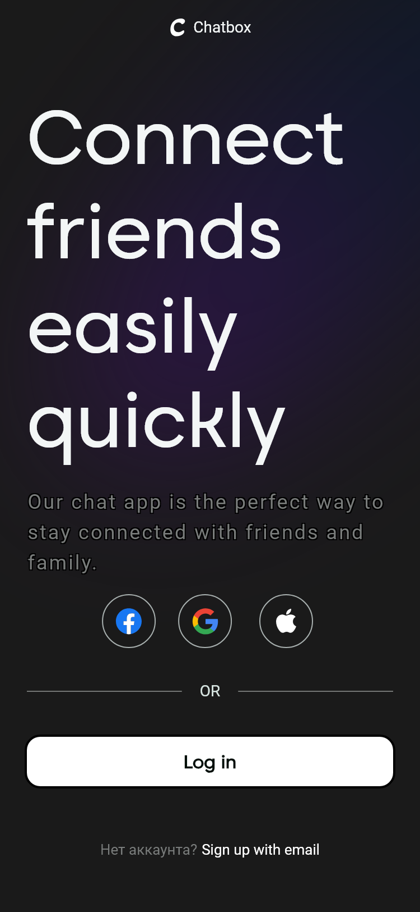
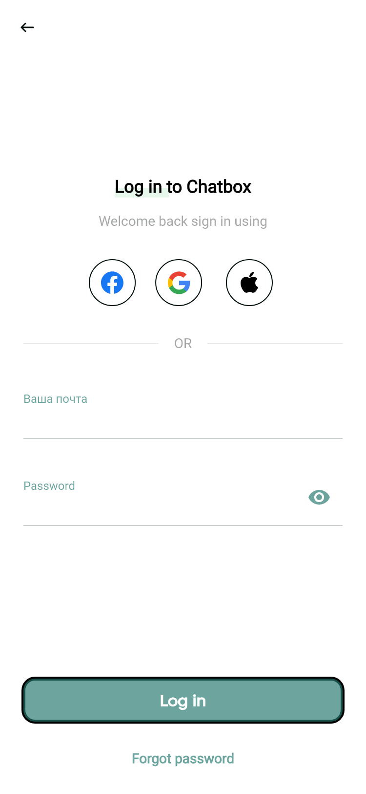
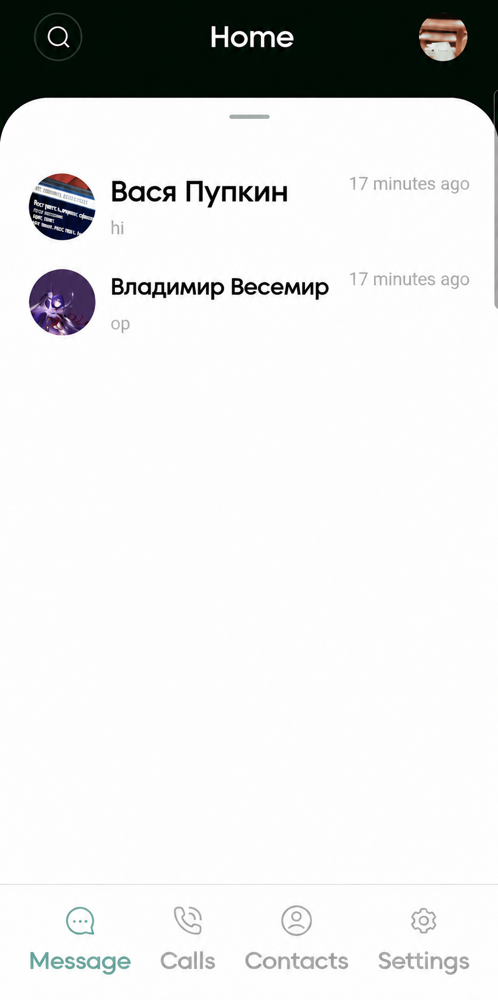

# ChatPet

Учебный pet-проект — мессенджер на Flutter, созданный для практики мобильной разработки. Здесь я отрабатываю Clean Architecture, управление состоянием через Cubit, работу с REST API и WebSocket, авторизацию и создание собственного UI-kit.

Проект развивается как площадка для экспериментов: функциональность и интерфейс могут меняться, а отдельные возможности ещё находятся в разработке.

## Скачать APK

[Скачать APK](https://github.com/XxJ0TaR0Xx/chat_pet/releases/tag/v0.1.0)

Ссылка будет добавлена после сборки и публикации APK.

## Перед запуском

**Если запускаете приложение с территории РФ, включите VPN.** Серверная часть размещена на [Render](https://render.com/), и подключение из России может быть нестабильным.

Запросы к серверу могут выполняться долго, в том числе при входе в аккаунт и загрузке чатов. Дождитесь завершения запроса; если соединение обрывается, проверьте VPN и попробуйте другую сеть.

## Скриншоты

Стартовый экран, вход в аккаунт и список чатов. Имена на скриншоте чатов заменены на демонстрационные.

<p>
  
  
  
</p>

## Что реализовано

- Регистрация, вход в аккаунт и обновление токенов.
- Личные чаты и обмен сообщениями через WebSocket.
- Ответы на сообщения, редактирование и удаление.
- Превью последних сообщений и счётчики непрочитанного.
- Контакты и заявки в друзья.
- Просмотр и редактирование профиля, загрузка аватара.
- Локализация на русский и английский языки.

## Технологии и архитектура

Flutter / Dart, flutter_bloc (Cubit), go_router, Dio, web_socket_channel, get_it / injectable, freezed, json_serializable, flutter_secure_storage, Firebase и flutter_intl.

Код разделён на слои:

```text
lib/
├── core/          # Конфигурация, DI, локализация и общая инфраструктура
├── domain/        # Модели, контракты репозиториев и use cases
├── data/          # API, WebSocket, DTO, мапперы и реализации репозиториев
└── presentation/  # Экраны, Cubit, навигация и UI-kit
```

## Запуск из исходников

Понадобятся Flutter SDK с Dart 3.10+ и собственная конфигурация Firebase.

1. Установите зависимости:

   ```bash
   flutter pub get
   ```

2. Настройте Firebase для своих Android/iOS-приложений:

   ```bash
   dart pub global activate flutterfire_cli
   flutterfire configure
   ```

   Используйте собственные конфиги Firebase. Пример структуры `google-services.json` находится в репозитории.

3. Скопируйте `general_configs.env.example` в `general_configs.env` и заполните значения из Firebase Console.

4. Сгенерируйте код и локализацию:

   ```bash
   dart run build_runner build --delete-conflicting-outputs
   dart run intl_utils:generate
   ```

5. Запустите приложение:

   ```bash
   flutter run
   ```

### Окружения

- **Debug / Profile:** при запуске появляется выбор Dev или Prod. До выбора серверные подключения не создаются.
- **Release:** автоматически используется Prod, без плашки выбора.

Адреса заданы в `lib/core/config/api_config.dart`:

- **Prod:** `https://chat-backend-9n4f.onrender.com`, WebSocket через WSS.
- **Dev:** `http://192.168.0.116:8000`, WebSocket через WS. Замените адрес на адрес своего локального сервера; для доступа к компьютеру из Android-эмулятора используется `10.0.2.2`.

Для смены окружения нужен полный перезапуск приложения. Hot reload сохраняет текущий выбор. Токены хранятся отдельно для каждого адреса сервера.


## Лицензия

[MIT](LICENSE)
